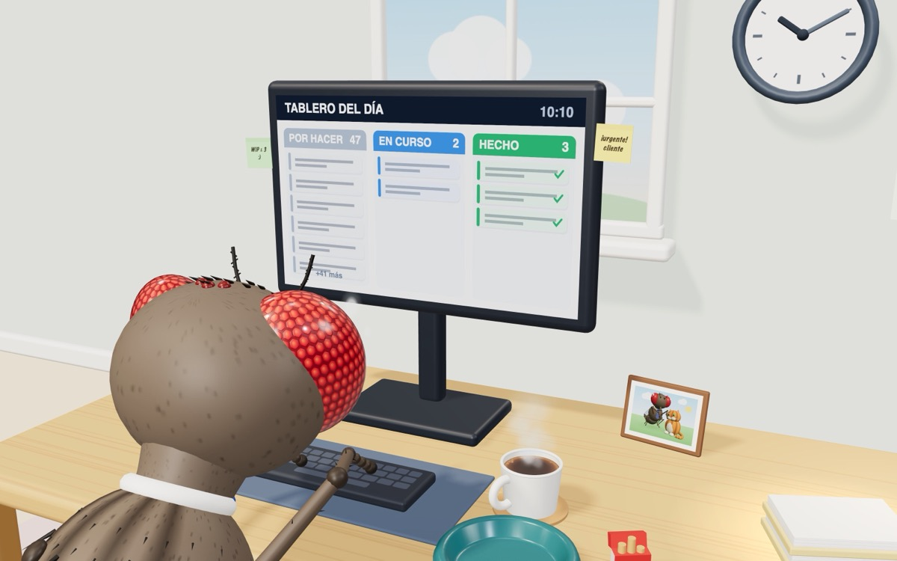
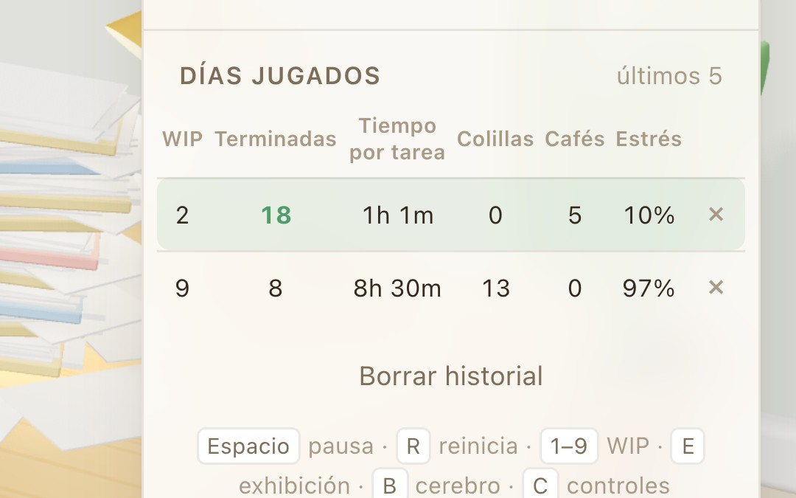

# Mosca del WIP

**Ocupado todo el día. ¿Y qué terminaste?**

Mosca del WIP es un juego gratis de un minuto, en el navegador, sobre limitar
el trabajo en curso (WIP). Tú eres el jefe de una mosca oficinista. Decides
cuántas tareas puede tener empezadas a la vez, de 1 a 10, y miras su día de
oficina. Las neuronas que se encienden en su cerebro vienen del mapa del
sistema nervioso de una mosca real.

Trae una guía, un informe con sus fuentes y un taller de 60 minutos, para que
un equipo encuentre su propio límite y lo pruebe. Todo es gratis, sin registro
y sin cookies, en español y en inglés.

**[Jugar](https://mosca.deliverycraft.ai/)** ·
[Guía del límite WIP](https://mosca.deliverycraft.ai/limite-wip/) ·
[Informe](https://mosca.deliverycraft.ai/informe/) ·
[Taller](https://mosca.deliverycraft.ai/taller/) ·
[Read me in English](README.md)



## Lo que se ve en el juego

La misma mosca y el mismo día de oficina, dos veces. En el juego, con 2 tareas
a la vez termina 18. Con 9 termina la mitad, aunque está ocupada todo el día.

| Tareas a la vez | Terminadas por día | Tiempo por tarea | Estrés al final del día |
| --- | --- | --- | --- |
| 1 | 15,9 | 34 min | Tranquila |
| 2 | 18,0 | 1 h | Tranquila |
| 3 | 16,9 | 1 h 36 min | Tranquila |
| 5 | 14,0 | 3 h 14 min | Ocupada |
| 9 | 9,1 | 8 h 54 min | Colapsada |
| 10 | 8,2 | 10 h 34 min | Colapsada |

Son números del juego, el promedio de 200 días simulados con cada límite. No
son números de personas ni de equipos. La tabla completa está en
[`public/datos/`](public/datos/) y en
[`docs/corrida-oficial.json`](docs/corrida-oficial.json).



## Úsalo en un taller

El taller trae una guía rápida para quien facilita, una presentación y una
hoja del equipo para imprimir. La sesión dura 60 minutos. El equipo mira un
día con 9 tareas a la vez y otro con 2, cuenta sus propias cosas en curso,
acuerda un límite y lo prueba dos semanas en el tablero que ya usa.

- La página del taller es https://mosca.deliverycraft.ai/taller/
- Los archivos están en [`public/taller/`](public/taller/).
- El taller tiene licencia CC BY 4.0. Puedes usarlo y adaptarlo, también en
  talleres pagados, citando al autor.
- ¿Lo usaste con un equipo? Cuenta cómo te fue en
  [este hilo](https://github.com/ferfelan/mosca-del-wip/issues/7).

El juego no dice el número de tu equipo. Cuánto gana tu equipo, lo dice su
prueba.

## Cómo correrlo en tu computador

Necesitas [Node.js](https://nodejs.org) 24.

```
git clone https://github.com/ferfelan/mosca-del-wip.git
cd mosca-del-wip
npm install
npm run dev
```

La portada se abre en http://localhost:5173/ y el juego en
http://localhost:5173/jugar/. Todo corre en el navegador. No hay servidor ni
base de datos.

`npm run build` arma el sitio en `dist/`.

Dos revisiones corren sin navegador.

```
node scripts/simular-dias.mjs       # repite la corrida oficial, 200 días con cada límite
node scripts/probar-urgencias.mjs   # revisa las reglas de las urgencias
```

Las demás revisiones, `scripts/probar-*.mjs`, manejan un navegador con
Playwright. Necesitan `npx playwright install` una vez y `npm run dev`
encendido.

| Carpeta | Qué hay |
| --- | --- |
| `src/` | El juego y las páginas. `brain.js` tiene las reglas del juego, `fly.js` y `office.js` dibujan la mosca y su oficina, `cerebro.js` dibuja el cerebro |
| `scripts/` | La simulación, los programas que arman las páginas y las revisiones |
| `scripts/datos/` | Programas en Python que preparan los datos del mapa del cerebro y corren el modelo |
| `public/` | Lo que el sitio entrega tal cual, como los datos del cerebro, los archivos del taller, los PDF y las tablas de datos |
| `docs/` | La evidencia, con las notas de investigación, los criterios escritos antes de cada corrida y los resultados |
| `docs/contexto/` | Las fuentes del informe, del resumen y del taller |

El código, sus comentarios y el historial están en español. El sitio está en
español y en inglés.

## La evidencia detrás

Cada número dice de dónde sale, si del juego, de la simulación o de estudios.

- **Las reglas del juego** se inspiran en estudios con personas. Que cada
  tarea tarde más cuando hay más abiertas, al mismo ritmo de salida, es un
  teorema (Little, 1961). El costo de cambiar de tarea sigue a Rubinstein,
  Meyer y Evans (2001) y a Weinberg (1992). Que el estrés suba con más tareas
  abiertas es un supuesto nuestro, inspirado en Mark, Gudith y Klocke (2008).
  Las fuentes respaldan la dirección del juego, no sus números.
- **La simulación** juega 200 días de oficina con cada límite y con una
  semilla fija, así que cualquiera puede repetirla y obtener la misma tabla.
  Las reglas y los criterios de éxito se escribieron y se guardaron antes de
  correr, y ningún número se ajustó después. Probamos 20 combinaciones de
  reglas, y en 16 de los 17 casos con esperas el mejor límite quedó entre 2
  y 4.
- **El cerebro** es el Male CNS v1.0, el mapa del sistema nervioso central de
  una mosca macho, con 166.700 neuronas. Simulamos las 164.587 que tienen sus
  conexiones completas, con un modelo simple que sigue a Shiu y otros (2024).
  La actividad que se ve es simulada. No es una grabación de una mosca viva, y
  el cerebro no prueba nada sobre las oficinas.

Dónde leer más.

- [`docs/NORTE.md`](docs/NORTE.md) dice qué afirma el proyecto y qué no.
- [`docs/etapa4-1-reglas.md`](docs/etapa4-1-reglas.md),
  [`docs/etapa4-2-reglas.md`](docs/etapa4-2-reglas.md) y
  [`docs/etapa8-2-criterios.md`](docs/etapa8-2-criterios.md) son las reglas y
  los criterios escritos antes de cada corrida. Sus resultados están en
  [`docs/etapa4-1.md`](docs/etapa4-1.md),
  [`docs/etapa4-2.md`](docs/etapa4-2.md) y
  [`docs/etapa8-2.md`](docs/etapa8-2.md).
- [`docs/etapa4-3.md`](docs/etapa4-3.md) cruza cada regla del juego con los
  estudios.
- [`docs/investigacion-etapa3.md`](docs/investigacion-etapa3.md),
  [`docs/investigacion-etapa4.md`](docs/investigacion-etapa4.md) y
  [`docs/investigacion-urgencias.md`](docs/investigacion-urgencias.md) son las
  notas de investigación, con sus fuentes.
- [`docs/README.md`](docs/README.md) lista todo lo que hay en esa carpeta.

## Qué es y qué no es

Es un juego y un experimento en el computador, con reglas basadas en estudios.
No mide personas ni equipos. Es una sola mosca y un solo día. Una prueba con
equipos reales sería otro proyecto, y todavía no se ha hecho.

## Cómo aportar

Las ideas, las correcciones y las traducciones son bienvenidas. Parte por
[CONTRIBUTING.es.md](CONTRIBUTING.es.md) y por las tareas marcadas como
[good first issue](https://github.com/ferfelan/mosca-del-wip/issues?q=is%3Aissue+is%3Aopen+label%3A%22good+first+issue%22).
Si lo usaste con un equipo, cuenta cómo te fue en
[este hilo](https://github.com/ferfelan/mosca-del-wip/issues/7). Con dos o tres
líneas basta, sin nombres de personas ni de empresas. Si hiciste el taller
completo, también hay un formulario más largo.

## Cómo está hecho

Felipe Fernández lo diseña, decide y lo prueba. El código se escribe con
[Claude Code](https://claude.com/claude-code). Cada cambio pasa por la misma
lista antes de subirse al sitio, con los dos idiomas, las revisiones de
`scripts/` y los documentos.

Este repositorio es la copia pública del proyecto. Las notas de trabajo del
autor y su informe completo, que es privado, quedaron fuera, y del historial se
sacaron los datos personales antes de publicarlo. Los commits conservan sus
fechas originales.

## Licencias

- El código tiene [licencia MIT](LICENSE).
- Los textos, las imágenes, el taller y los datos tienen licencia CC BY 4.0.
- El informe y el resumen ejecutivo se pueden compartir tal cual, citando al
  autor.
- Los datos del cerebro de la mosca, las letras y las bibliotecas son de sus
  autores.

El detalle está en [LICENSE-CONTENT.md](LICENSE-CONTENT.md) y en
[THIRD-PARTY-NOTICES.md](THIRD-PARTY-NOTICES.md).

## Créditos

El cerebro es el Male CNS v1.0, con licencia CC BY 4.0 y adaptado para el
juego.

> This project is a collaboration between FlyEM (HHMI Janelia), the University
> of Cambridge (Dept. of Zoology), the MRC Laboratory of Molecular Biology, and
> Google Research.

Hecho por [Felipe Fernández](https://www.linkedin.com/in/felipefernandezandrade/).
