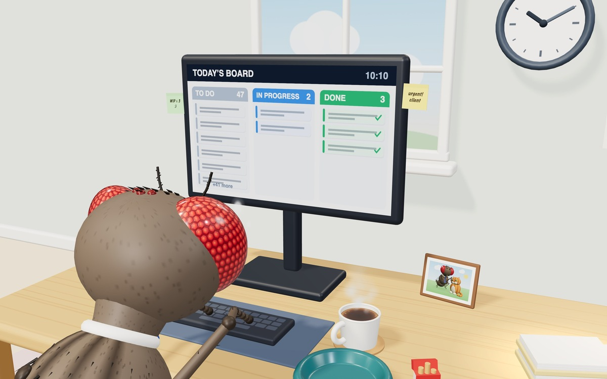
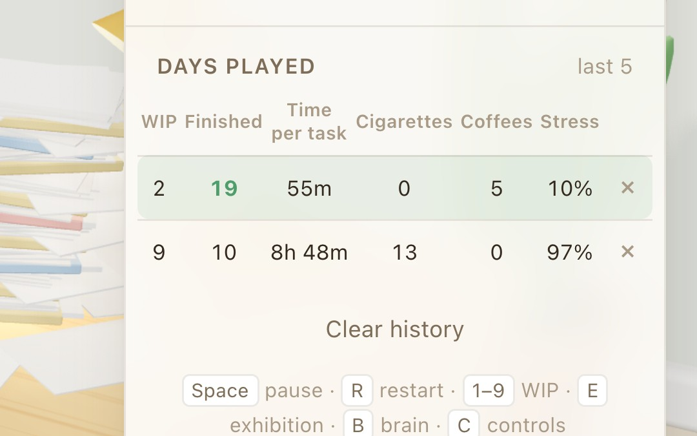

# Mosca del WIP

**Busy all day. So what did you finish?**

Mosca del WIP is a free one-minute browser game about limiting work in
progress (WIP). You are the boss of an office fly. You decide how many tasks
she can have started at once, from 1 to 10, and you watch her day at the
office. The neurons that light up in her brain come from the map of a real
fly's nervous system.

It comes with a guide, a report with its sources and a 60-minute workshop kit,
so a team can find its own limit and test it. Everything is free, with no
sign-up and no cookies, in Spanish and English. *Mosca* means fly in Spanish.

**[Play the game](https://mosca.deliverycraft.ai/en/)** ·
[WIP limit guide](https://mosca.deliverycraft.ai/en/wip-limit/) ·
[Report](https://mosca.deliverycraft.ai/en/report/) ·
[Workshop](https://mosca.deliverycraft.ai/en/workshop/) ·
[Léeme en español](README.es.md)



## What you see in the game

The same fly and the same office day, twice. In the game, with 2 tasks at once
she finishes 18. With 9 she finishes half as many, even though she is busy all
day.

| Tasks at once | Finished per day | Time per task | Stress at the end of the day |
| --- | --- | --- | --- |
| 1 | 15.9 | 34 min | Calm |
| 2 | 18.0 | 1 h | Calm |
| 3 | 16.9 | 1 h 36 min | Calm |
| 5 | 14.0 | 3 h 14 min | Busy |
| 9 | 9.1 | 8 h 54 min | Overwhelmed |
| 10 | 8.2 | 10 h 34 min | Overwhelmed |

These are numbers from the game, the average of 200 simulated days for each
limit. They are not numbers about people or teams. The full table is in
[`public/datos/`](public/datos/) and in
[`docs/corrida-oficial.json`](docs/corrida-oficial.json).



## Use it in a workshop

The kit has a quick guide for the facilitator, slides and a team sheet to
print. The session takes 60 minutes. The team watches one day with 9 tasks at
once and one with 2, counts its own things in progress, agrees on a limit and
tests it for two weeks on the board it already uses.

- The workshop page is https://mosca.deliverycraft.ai/en/workshop/
- The files are in [`public/taller/`](public/taller/). For now they are in
  Spanish.
- The kit is licensed CC BY 4.0. You can use it and adapt it, also in paid
  workshops, crediting the author.
- Did you use it with a team? Tell how it went in
  [this thread](https://github.com/ferfelan/mosca-del-wip/issues/7).

The game does not tell you your team's number. Your team's own test will show
how much it gains.

## Run it on your computer

You need [Node.js](https://nodejs.org) 24.

```
git clone https://github.com/ferfelan/mosca-del-wip.git
cd mosca-del-wip
npm install
npm run dev
```

The home page opens at http://localhost:5173/ and the game at
http://localhost:5173/jugar/. Everything runs in the browser. There is no
server and no database.

`npm run build` builds the site in `dist/`.

Two checks run without a browser.

```
node scripts/simular-dias.mjs       # replays the official run, 200 days for each limit
node scripts/probar-urgencias.mjs   # checks the rules for urgent tasks
```

The other checks, `scripts/probar-*.mjs`, drive a browser with Playwright. They
need `npx playwright install` once and `npm run dev` running.

| Folder | What is there |
| --- | --- |
| `src/` | The game and the pages. `brain.js` has the rules of the game, `fly.js` and `office.js` draw the fly and her office, `cerebro.js` draws the brain |
| `scripts/` | The simulation, the page generators and the checks |
| `scripts/datos/` | Python scripts that prepare the connectome data and run the brain model |
| `public/` | What the site serves as is, such as the brain data, the workshop files, the PDF files and the data tables |
| `docs/` | The evidence, with the research notes, the criteria written before each run and the results |
| `docs/contexto/` | The sources of the report, the summary and the workshop |

The code, its comments and the commit history are in Spanish. The site is in
Spanish and English.

## The evidence behind it

Every number says where it comes from, whether the game, the simulation or
studies.

- **The rules of the game** are inspired by studies with real people. That each
  task takes longer when more are open, at the same output rate, is a theorem
  (Little, 1961). The cost of switching tasks follows Rubinstein, Meyer and
  Evans (2001) and Weinberg (1992). That stress goes up with more open tasks
  is our own assumption, inspired by Mark, Gudith and Klocke (2008). The
  sources back the direction of the game, not its numbers.
- **The simulation** plays 200 office days for each limit with a fixed seed,
  so anyone can repeat it and get the same table. The rules and the success
  criteria were written and committed before running, and no number was
  adjusted afterward. We tried 20 combinations of rules, and in 16 of the 17
  cases with waits the best limit landed between 2 and 4.
- **The brain** is Male CNS v1.0, the map of the central nervous system of a
  male fruit fly, with 166,700 neurons. We simulate the 164,587 whose
  connections are complete, with a simple model that follows Shiu et al.
  (2024). The activity you see is simulated. It is not a recording of a living
  fly, and the brain proves nothing about offices.

Where to read more.

- [`docs/NORTE.md`](docs/NORTE.md) says what the project claims and what it
  does not.
- [`docs/etapa4-1-reglas.md`](docs/etapa4-1-reglas.md),
  [`docs/etapa4-2-reglas.md`](docs/etapa4-2-reglas.md) and
  [`docs/etapa8-2-criterios.md`](docs/etapa8-2-criterios.md) are the rules and
  criteria written before each run. Their results are in
  [`docs/etapa4-1.md`](docs/etapa4-1.md),
  [`docs/etapa4-2.md`](docs/etapa4-2.md) and
  [`docs/etapa8-2.md`](docs/etapa8-2.md).
- [`docs/etapa4-3.md`](docs/etapa4-3.md) crosses each rule of the game with
  the studies.
- [`docs/investigacion-etapa3.md`](docs/investigacion-etapa3.md),
  [`docs/investigacion-etapa4.md`](docs/investigacion-etapa4.md) and
  [`docs/investigacion-urgencias.md`](docs/investigacion-urgencias.md) are the
  research notes, with their sources.
- [`docs/README.md`](docs/README.md) lists everything in that folder. These
  documents are in Spanish.

## What it is and what it is not

It is a game and a computer experiment, with rules based on studies. It does
not measure people or teams. It is a single fly and a single day. A test with
real teams would be another project, and it has not been done yet.

## How to contribute

Ideas, corrections and translations are welcome. Start with
[CONTRIBUTING.md](CONTRIBUTING.md) and with the issues labeled
[good first issue](https://github.com/ferfelan/mosca-del-wip/issues?q=is%3Aissue+is%3Aopen+label%3A%22good+first+issue%22).
If you used it with a team, tell how it went in
[this thread](https://github.com/ferfelan/mosca-del-wip/issues/7). Two or three
lines are enough, with no names of people or companies. If you ran the full
workshop, there is also a longer issue form.

## How it is made

Felipe Fernández designs it, decides and tests it. The code is written with
[Claude Code](https://claude.com/claude-code). Each change goes through the
same list before it is published, with both languages, the checks in
`scripts/` and the documents.

This repository is the public copy of the project. The author's working notes
and his private full report are kept out of it, and personal data was removed
from the history before publishing. The commits keep their original dates.

## Licenses

- The code is under the [MIT license](LICENSE).
- The texts, the images, the workshop and the data are under CC BY 4.0.
- The report and the executive summary can be shared unchanged, crediting the
  author.
- The fly brain data, the fonts and the libraries belong to their authors.

The details are in [LICENSE-CONTENT.md](LICENSE-CONTENT.md) and
[THIRD-PARTY-NOTICES.md](THIRD-PARTY-NOTICES.md).

## Credits

The brain is Male CNS v1.0, licensed CC BY 4.0 and adapted for the game.

> This project is a collaboration between FlyEM (HHMI Janelia), the University
> of Cambridge (Dept. of Zoology), the MRC Laboratory of Molecular Biology, and
> Google Research.

Made by [Felipe Fernández](https://www.linkedin.com/in/felipefernandezandrade/).
